# 🎮 REVERIE 2K27 — THE PIXELVERSE
### The Flagship Interactive Techno-Cultural Festival Web Experience • IIIT Kota

<p align="center">
  
</p>

<p align="center">
  <a href="https://react.dev/"></a>
  <a href="https://phaser.io/"></a>
  <a href="https://vitejs.dev/"></a>
  <a href="https://tailwindcss.com/"></a>
  <a href="https://threejs.org/"></a>
</p>

> *"ENTER THE WORLD. EXPLORE THE FEST. UNLOCK THE EXPERIENCE."*

**REVERIE 2K27: The Pixelverse** is an interactive 2D retro-arcade web experience built for the annual flagship techno-cultural festival of the **Indian Institute of Information Technology Kota (IIIT Kota)**. It blends 16-bit platformer gameplay, live festival schedules, interactive sponsor mini-games, and event registrations into a single web application.

---

## 🌟 Key Highlights

### 🏰 1. Living Realms with 16-Bit Master Pixel Art Backdrops
Every realm in the Pixelverse features handcrafted 16-bit panoramic pixel art that scrolls with multi-layer parallax depth:

- **Starting Kingdom (`StartingKingdomScene`)**:
  - Super Mario / Yoshi's Island fantasy kingdom with lush rolling hills and twilight shadows.
  - Giant glowing full moon, floating pastel clouds, magical mushroom trees, and distant fairytale castle atop misty cliffs.
  - Welcome portal arch, Kota Bot guide, skins wardrobe, and warp tunnels.
- **Tech Kingdom (`TechKingdomScene`)**:
  - Cyberpunk Neo-Tokyo metropolis at night with flying hovercraft, light trails, and towering mega-corps.
  - Neon Japanese and English holographic billboards (*"TECH KINGDOM"*, *"CYBERNETICS"*, *"GALAXY ARCADE"*).
  - Translucent cyber monolith terminals showcasing **7 Technical Competitions** (*Endeavour*, *Byte-Break*, *DSA Sprint*, *TradeX*, *Summit League*, *DesignX*, *Robo Soccer*).
- **Culture Kingdom (`CultureKingdomScene`)**:
  - Outdoor EDM & Rock concert mainstage at night with giant LED festival video walls.
  - Dynamic concert spotlights and laser beams cutting through the magenta night sky.
  - Line array speaker towers with cheering festival crowd silhouettes showcasing **7 Cultural Events** (*Botanical Bid*, *Among Us*, *Band Night*, *Squid Game*, *Concert Night*, *Fashion Show*, *Dance Battle*).
- **Festival Plaza (`FestivalPlazaScene`)**:
  - IIIT Kota campus expo plaza with illuminated modern pavilions (*"TECH EXPO"*, *"GRAND CAMPUS"*, *"GLOBAL FESTIVAL"*).
  - Cascading water fountains, geodesic domes, festive string lights, carnival crowds, and multi-colored fireworks bursting in the night sky.
  - Central honor pavilion, past sponsor perks, photo gallery, and festival secretariat directory.

---

### 🕹️ 2. The 4-Stage Retro Arcade Universe

Players can enter the Arcade Universe directly from the landing page or by ducking into the **`WARP TUNNEL: ARCADE`** in-game:

```
  ┌─────────────────────────────────────────────────────────────┐
  │                 REVERIE 2K27 ARCADE UNIVERSE                │
  ├─────────────────────────────────────────────────────────────┤
  │  Stage 1: PAC-MAN SCHEDULE  ──▶  Stage 2: SPONSOR GALAXY   │
  │            │                                │               │
  │            ▼                                ▼               │
  │  Stage 3: FAQ SANCTUARY     ──▶  Stage 4: CASTLE CLEAR      │
  └─────────────────────────────────────────────────────────────┘
```

1. **Sonic Floating Islands Stage Selector (`SonicStageSelector`)**:
   - Checkered Green Hill 3D floating islands with waterfalls, palm trees, golden rings, and bouncing spring bumpers.
   - Interactive Sonic sprite jumping to the selected island with keyboard or arrow navigation.
2. **Stage 1: Pac-Man 18-Event Schedule on Rails (`PacmanScheduleMaze`)**:
   - Continuous 3-day festival circuit with dual steel rails, sleeper ties, and animated neon energy pulses:
     - **Day 1 (Gold Rails)**: 5 Inauguration & Hack Sprint events
     - **Day 2 (Cyan Rails)**: 6 24h Code War & Robotics events
     - **Day 3 (Hot Magenta Rails)**: 7 Showcase & Pronite Concert events
   - Big chomping Pac-Man, patrolling ghosts (*Inky* & *Pinky*), and power pellets.
   - Interactive canvas: click any event station to cruise Pac-Man to it and inspect event rules or register via Unstop.
3. **Stage 2: Sponsor Galaxy Space Shooter (`SponsorGalaxy`)**:
   - 90s arcade vertical space shooter.
   - Pilot your starfighter, destroy alien sponsor ships carrying official partner logos (Google, Replit, Solana, Red Bull, Intel, GitHub, etc.), and collect dropped power-up shields and score multipliers.
4. **Stage 3: RPG FAQ Sanctuary (`RpgFaqSanctuary`)**:
   - 16-bit Game Master sage with animated typewriter dialogue and scroll selector answering festival FAQs (Registration, Tickets, Venue, Cash Prizes, Schedules).
5. **Stage 4: Stages Cleared & Castle Victory (`VictoryStageClear`)**:
   - Authentic 16-bit Peach's Castle with twin red conical turrets, stone battlements, stained glass rose window, and flying sponsor banners.
   - Flagpole sliding Mario with score bonuses (+5000 Platinum, +2000 Gold, +1000 Silver) and Toad mascot celebration.

---

### ⚡ 3. Warp Tunnel System
- **`WARP TUNNEL: TECH REALM`** (Green Pipe)
- **`WARP TUNNEL: CULTURE REALM`** (Pink Pipe)
- **`WARP TUNNEL: ARCADE`** (Gold Pipe) — Replaces the legacy flagship pipe and directly launches the Arcade Quest
- **`WARP TUNNEL: FESTIVAL PLAZA`** (White Pipe)
- **`WARP TUNNEL: 8-BIT SECRET VAULT`** (Hidden golden pipe past the flagpole)

Each warp pipe triggers player ducking, procedural pipe sound synthesis, and a hyperspace warp tunnel overlay.

---

### 👔 4. Hero Wardrobe & Character Skins
Switch in real-time between 5 character sprites:
- 🔴 **Classic Mario** — The timeless 8-bit platforming icon
- 🔷 **Cyber Neon Explorer** — Futuristic glowing visor and cyan palette
- 🟡 **Golden Champion** — Gilded champion skin with sparkle trail
- 🟣 **Synthwave Punk** — Neon magenta-and-indigo 80s aesthetic
- 🌌 **Cosmic REVERIE Edition** — Special festival edition skin

---

### 🎵 5. Procedural Web Audio Engine
Built with zero external audio assets using the browser's native **Web Audio API**:
- Square & triangle wave tone synthesis for authentic retro game sounds.
- Chiptune blips, jump sfx, coin pickups, pipe warps, laser fire, explosions, and fanfare melodies.

---

## 🕹️ Controls Guide

| Action | Desktop Keyboard | Mobile Touch Screen |
| :--- | :--- | :--- |
| **Move Left / Right** | `A` / `D` or `Arrow Keys` | Virtual D-Pad Left / Right |
| **Jump / Super-Jump** | `W`, `Up Arrow`, or `Space` | Virtual Jump Button (A) |
| **Enter Pipe / Talk / Inspect** | `E` or `Enter` | Action Button (B) / Tap Character |
| **Fast Travel Map** | Top Nav `MAP` | Mobile Bottom `MAP` Pill |
| **All 18 Events Directory** | Top Nav `EVENTS` | Mobile `DIRECTORY` Button |
| **Arcade Quest** | Top Nav `ARCADE` or Gold Pipe | Mobile `PLAY ARCADE` Button |
| **Close Modals** | `Escape` key | `✕ EXIT` Button |

---

## 🛠️ Technology Stack

| Layer | Technologies |
| :--- | :--- |
| **Framework** | [React 19](https://react.dev/) + [Vite 8](https://vitejs.dev/) |
| **Game Engine** | [Phaser 4](https://phaser.io/) (Arcade Physics, Tilemaps, Cameras) |
| **Styling & UI** | [Tailwind CSS v4](https://tailwindcss.com/), [Lucide React](https://lucide.dev/) |
| **3D & FX** | [Three.js](https://threejs.org/) (Floating Voxel Backgrounds), Canvas Confetti |
| **Audio** | Custom Web Audio API Synthesizer (`SoundEngine.js`) |
| **Testing** | Puppeteer Core (Automated view and responsive verification) |

---

## 📁 Project Structure

```
reverie-pixelverse/
├── public/
│   └── assets/
│       ├── backgrounds/         # 16-bit master pixel art backgrounds
│       │   ├── bg_starting_master.jpg
│       │   ├── bg_tech_master.jpg
│       │   ├── bg_culture_master.jpg
│       │   └── bg_plaza_master.jpg
│       ├── branding/            # REVERIE 2K27 official logos & emblems
│       ├── events/              # Event posters & thumbnails (18 events)
│       ├── sponsors/            # Official sponsor brand logos
│       └── sprites/             # Pipes, coins, question blocks, avatars
├── src/
│   ├── components/
│   │   ├── Arcade/              # Retro Arcade Universe
│   │   │   ├── ArcadeAdventureModal.jsx
│   │   │   ├── SonicStageSelector.jsx
│   │   │   ├── PacmanScheduleMaze.jsx
│   │   │   ├── SponsorGalaxy.jsx
│   │   │   ├── RpgFaqSanctuary.jsx
│   │   │   └── VictoryStageClear.jsx
│   │   ├── GameCanvas/          # Phaser 4 canvas lifecycle
│   │   ├── GameHUD/             # In-game HUD, coin balance, and quest tracker
│   │   ├── Modals/              # Directory, Fast Travel, Gallery, Sponsors, Stats
│   │   ├── StartScreen/         # Flagship 3D entrance & hero stage
│   │   └── ThreeD/              # Three.js 3D ambient floating background
│   ├── data/
│   │   ├── events.js            # 18 festival event dossiers, rules & prize pools
│   │   ├── schedule.js          # Day 1, 2, 3 chronological event timeline
│   │   ├── sponsors.js          # Tiered sponsors (Title, Platinum, Gold, Silver)
│   │   └── achievements.js      # Unlockable festival quests & badges
│   └── game/
│       ├── entities/            # Player, NPC, WarpPipe, Collectibles, EventPortals
│       ├── scenes/              # Phaser Scenes (Starting, Tech, Culture, Plaza, Vault)
│       └── systems/             # SoundEngine, AchievementSystem, EventBus
└── README.md
```

---

## 🚀 Getting Started

### Prerequisites
- **Node.js** (v18.0.0 or higher recommended)
- **npm** (v9.0.0 or higher)

### Installation

```bash
# 1. Clone the repository
git clone https://github.com/AyushSrivastava1818/Reverie-2k27.git

# 2. Navigate into project folder
cd Reverie-2k27/reverie-pixelverse

# 3. Install dependencies
npm install

# 4. Start Vite local development server
npm run dev
```

Open your browser and navigate to **[http://localhost:3000](http://localhost:3000)** to enter the Pixelverse.

### Production Build

```bash
# Build production bundle
npm run build

# Preview production build locally
npm run preview
```

---

## 📜 Festival Credits & License

- **Festival**: REVERIE 2K27 (Flagship Techno-Cultural Festival)
- **Institution**: Indian Institute of Information Technology Kota (IIIT Kota)
- **Developer**: Ayush Srivastava ([@AyushSrivastava1818](https://github.com/AyushSrivastava1818))
- **License**: MIT License. Created for IIIT Kota REVERIE 2K27.
